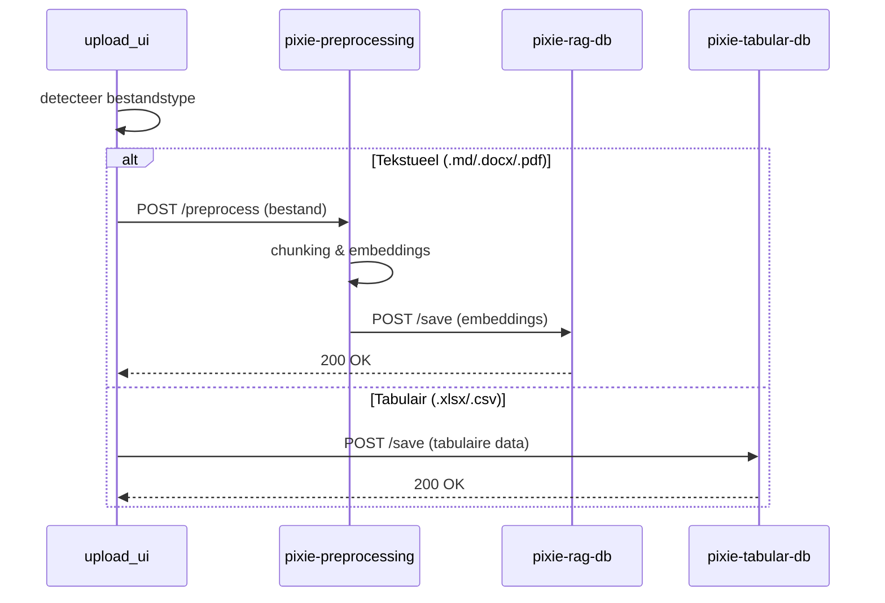
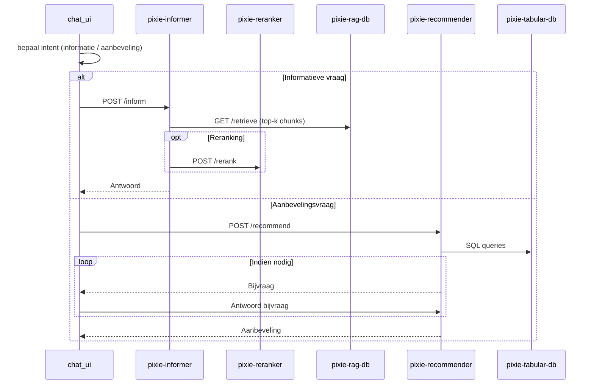

# 📚 PiXie – High-level Architectuur & Dataflow

## 🧭 Overzicht

De PiXie-architectuur bestaat uit meerdere gespecialiseerde microservices die elk een duidelijk afgebakende verantwoordelijkheid hebben.  
De UI-componenten communiceren via API-calls met deze services om documenten te verwerken, embeddings op te slaan en vragen van gebruikers te beantwoorden.

## 🧩 Componenten

| Component              | Type        | Status         | Rol                                                                                          |
|-------------------------|------------|----------------|-----------------------------------------------------------------------------------------------|
| `upload_ui`            | Frontend   | ✅ Actief      | Laat gebruikers documenten uploaden en start preprocess- en opslagflow                       |
| `chat_ui`              | Frontend   | ✅ Actief      | Laat gebruikers vragen stellen en toont antwoorden (informer of recommender)                  |
| `pixie-preprocessing`  | Backend    | ❌ In ontwikkeling | Verwerkt tekstuele documenten (md, docx, pdf) → chunking → embeddings genereren               |
| `pixie-rag-db`         | Backend    | ❌ In ontwikkeling | Qdrant vectorstore – opslag en retrieval van embeddings                                       |
| `pixie-tabular-db`     | Backend    | ✅ Actief      | PostgreSQL-database voor tabulaire data (csv, xlsx)                                          |
| `pixie-informer`       | Backend    | ❌ In ontwikkeling | Retrieval & orchestratie van informatieve vragen                                            |
| `pixie-reranker`       | Backend    | ❌ In ontwikkeling | Rerankt retrieved chunks op relevantie                                                       |
| `pixie-recommender`    | Backend    | ✅ Actief      | Orkestreert aanbevelings- of keuzehulpscenario’s op basis van tabulaire data                 |

---

## 📤 Upload Flow

### Beschrijving
Wanneer een gebruiker een document uploadt via `upload_ui`:

1. UI bepaalt het bestandstype.  
2. Indien **tekstueel** (.md, .docx, .pdf):  
   - UI → `POST /preprocess` naar `pixie-preprocessing`  
   - Preprocessing → chunking + embedding  
   - Embeddings → `POST /save` naar `pixie-rag-db`  
3. Indien **tabulair** (.xlsx, .csv):  
   - UI → `POST /save` naar `pixie-tabular-db`  

### Mermaid-diagram

---

## 💬 Chat Flow

### Beschrijving
Wanneer een gebruiker een vraag stelt via `chat_ui`:

1. UI verstuurt vraag → intent wordt bepaald.  
2. **Als het een informatieve vraag is**:  
   - `chat_ui` → `pixie-informer`  
   - Informer → `pixie-rag-db` (retrieve chunks)  
   - Optioneel: informer → `pixie-reranker` (rerank)  
   - Informer formuleert antwoord en stuurt terug naar UI.  
3. **Als het een aanbevelingsvraag is**:  
   - `chat_ui` → `pixie-recommender`  
   - Recommender → `pixie-tabular-db` (queries)  
   - Bijvragen indien nodig, daarna aanbeveling terug naar UI.

### Mermaid-diagram

---

## 🛠️ Belangrijke eigenschappen

- **Duidelijke scheiding per verantwoordelijk domein**  
  → Elke service doet één ding goed (preprocess, storage, retrieval, recommendation).  
- **Filetype bepaalt verwerkingspad**  
  → Tekstuele documenten gaan naar embeddings, tabulaire naar Postgres.  
- **Orchestratie ligt nu bij UI**  
  → UI bepaalt pad en maakt meerdere API-calls. (→ kandidaat voor toekomstige BFF)  
- **Flexibele uitbreidbaarheid**  
  → Extra services (bv. summarizer, classifier) kunnen makkelijk worden toegevoegd.

---

## 📌 Samenvatting

De huidige PiXie-architectuur gebruikt meerdere microservices met duidelijke verantwoordelijkheden.  
De frontend (`upload_ui` en `chat_ui`) regelt de orchestratie via API-calls naar preprocessing, opslag, retrieval en aanbeveling.  
Deze aanpak werkt goed voor modulariteit en flexibiliteit, maar kan op termijn geoptimaliseerd worden via een BFF-laag, asynchrone verwerking en betere observability.
