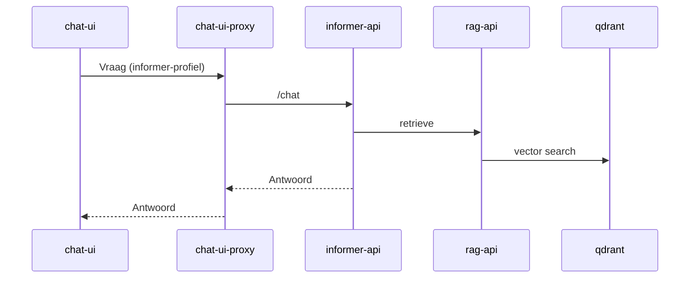
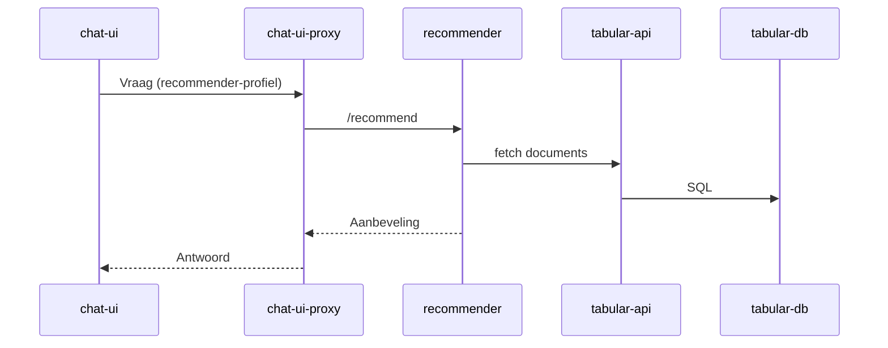
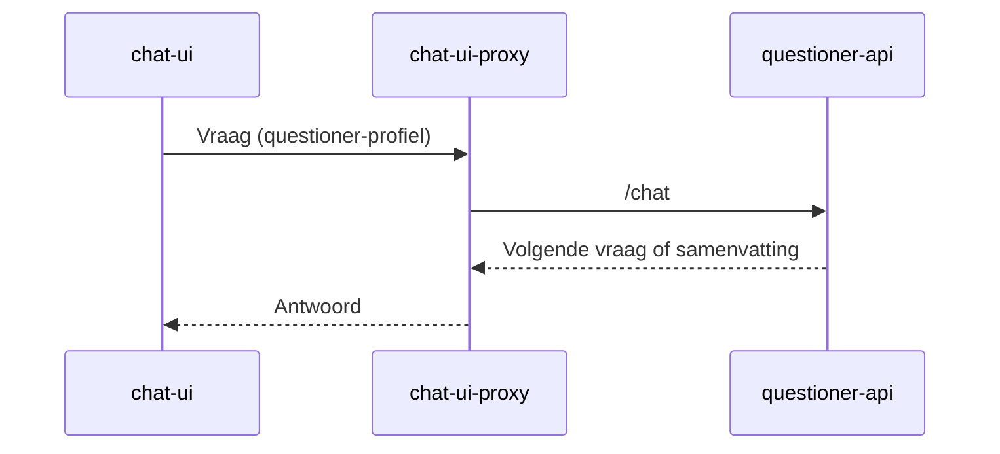
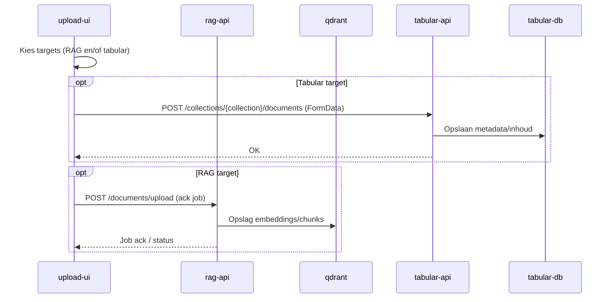

# PiXie – Architectuur & Compose-profielen

## Overzicht

PiXie bestaat uit een set containers die je per profiel kunt starten:

- `informer` – vraag/antwoord via RAG
- `recommender` – aanbevelingen op tabulaire data
- `questioner` – intake/vraaggesprek dat uitmondt in een samenvatting
- `all` – alle profielen tegelijk

Start voorbeelden:

```bash
docker compose --profile informer up -d --build
docker compose --profile recommender up -d --build
docker compose --profile questioner --profile ui-standard up -d --build
docker compose --profile questioner --profile ui-kiosk up -d --build
docker compose --profile all up -d --build
# alles stoppen: docker compose --profile all --profile informer --profile recommender --profile questioner --profile ui-standard --profile ui-kiosk down --remove-orphans
```

Security default: alleen de chat-gateway op poort `3000` is extern bereikbaar.
Interne API/DB-poorten (zoals Redis, Qdrant, audit API, upload UI) zijn naar
`127.0.0.1` gebonden.

Je kunt ook `COMPOSE_PROFILES` in `.env` zetten (bijv. `COMPOSE_PROFILES=informer`, `COMPOSE_PROFILES=questioner,ui-standard` of `COMPOSE_PROFILES=questioner,ui-kiosk`). Dan volstaat `docker compose up -d`/`down`. Per run overschrijven kan altijd met `--profile`.

Voor questioner zijn er twee UI-modi:

- `ui-standard` start de klassieke `chat-ui` samen met `chat-ui-proxy`
- `ui-kiosk` start de afgeslankte kiosk-UI zonder `chat-ui-proxy`
- beide modi halen branding en basiscopy uit `cases/<CASE_ID>/client.env` en `cases/<CASE_ID>/branding`
- de questioner stack is niet langer hard gepind op `linux/amd64`, zodat Docker op een Jetson de `linux/arm64` varianten kan pullen zodra die images gepubliceerd zijn

Gebruik voor questioner exact één van die twee UI-profielen tegelijk.

## Cases (klantbundels)

Alle klant-specifieke onderdelen zitten in `cases/<CASE_ID>/` en worden als één bundel gemount naar `/case`.
Zo houd je de core generiek en wissel je per klant alleen de case-map.

Structuur (voorbeeld):

```
cases/
  brooklyn/
    client.env
    secrets.env
    branding/
    prompts/
    locations.caddy
    notes.md
  _template/
    client.env.example
    secrets.env.example
    branding/
    prompts/
    locations.caddy
    notes.md
```

Snel starten met een klant:
1) Zet `CASE_ID=<klant>` in `.env`
2) Zorg dat `cases/<klant>/client.env` en `cases/<klant>/secrets.env` bestaan
3) Kies `COMPOSE_PROFILES` passend bij je frontendmodus
4) Start met `docker compose up -d`

Voorbeeld questioner op Jetson:

```env
CASE_ID=cretskens
COMPOSE_PROFILES=questioner,ui-kiosk
```

Voorbeeld standaard questioner UI:

```env
CASE_ID=brooklyn
COMPOSE_PROFILES=questioner,ui-standard
```

Nieuwe klant aanmaken:
1) Kopieer `cases/_template` naar `cases/<klant>`
2) Vul `client.env` en `secrets.env` in
3) Voeg branding en prompts toe

Checklist (nieuwe klant):
- `cases/<klant>/client.env` gevuld (geen secrets)
- `cases/<klant>/secrets.env` gevuld (wel secrets, niet committen)
- `cases/<klant>/branding` bevat logo/background
- `cases/<klant>/prompts` gevuld (als questioner gebruikt)
- `cases/<klant>/locations.caddy` bijgewerkt (of `default ""` laten)
- `CASE_ID=<klant>` gezet in `.env`

Locaties (QR):
- `cases/<klant>/locations.caddy` bevat de code → locatie mapping
- Geen QR-locaties? Laat alleen `default ""` staan (preset in template)

Let op:
- `secrets.env` staat in `.gitignore` en wordt niet gecommit
- Houd `ACTIVE_CLIENT_ID` gelijk aan de case-mapnaam

## Componenten (huidig)

| Component            | Type      | Rol                                                                                   |
|----------------------|-----------|----------------------------------------------------------------------------------------|
| `rag-api`            | FastAPI   | Retrievallaag voor RAG: ontvangt queries, haalt context op uit Qdrant en serveert antwoorden. |
| `qdrant`             | Vector DB | Vectorstore voor embeddings en similarity search.                                      |
| `informer-api`       | FastAPI   | Orkestreert informatieve Q&A bovenop rag-api: intenthandling, context ophalen, antwoord bouwen. |
| `tabular-db`         | Postgres  | Relationele opslag voor tabulaire datasets.                                            |
| `tabular-api`        | FastAPI   | API voor tabulaire data: CRUD/query bovenop Postgres voor de recommender.              |
| `recommender`        | FastAPI   | Aanbevelingsengine op tabulaire data; kan bijvragen en levert keuzes/adviezen.         |
| `questioner-api`     | FastAPI   | Orkestreert vraaggesprek en genereert samenvattingen.                                  |
| `chat-ui-*`          | Frontend  | Chat UI (per profiel/all) waar gebruikers vragen stellen en antwoorden zien.           |
| `chat-kiosk-ui-*`    | Frontend  | Lichtgewicht kiosk UI voor single-screen questioner deployments.                        |
| `chat-ui-proxy-*`    | BFF/proxy | Proxy/BFF die chatverkeer routeert naar informer-, recommender- en/of questioner-API.  |
| `upload-ui-*`        | Frontend  | Upload UI waarmee documenten ingest worden richting informer/rag-pijplijn.             |

## Containers per profiel

- `informer`: qdrant, rag-api, informer-api, chat-ui-informer, chat-ui-proxy-informer, upload-ui-informer
- `recommender`: tabular-db, tabular-api, recommender, chat-ui-recommender, chat-ui-proxy-recommender, upload-ui-recommender
- `questioner` + `ui-standard`: questioner-api, chat-ui-questioner, chat-ui-proxy-questioner, chat-gateway
- `questioner` + `ui-kiosk`: questioner-api, chat-kiosk-ui-questioner, chat-gateway-kiosk
- `all`: combinatie van alle drie plus de `*-all` UI/proxy varianten

## Mermaid – Chat flow (informer)



## Mermaid – Chat flow (recommender)



## Mermaid – Chat flow (questioner)



## Mermaid – Upload flow (RAG / tabular)



## Healthchecks & depends_on

- Health: `/health` voor rag-api, informer-api, tabular-api, recommender; `/healthz` voor qdrant. Startperiod: rag-api 120s (model load); qdrant 20s; de rest 15s.
- Afhankelijkheden met `condition: service_healthy`: qdrant→rag-api, rag/qdrant→informer-api, tabular-db→tabular-api, tabular-api→recommender.
