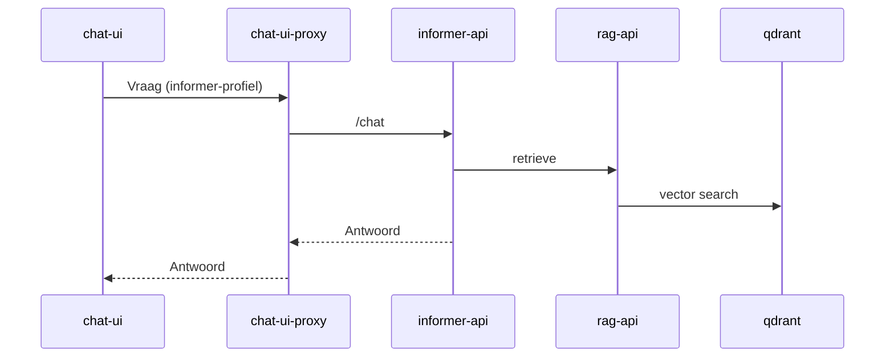
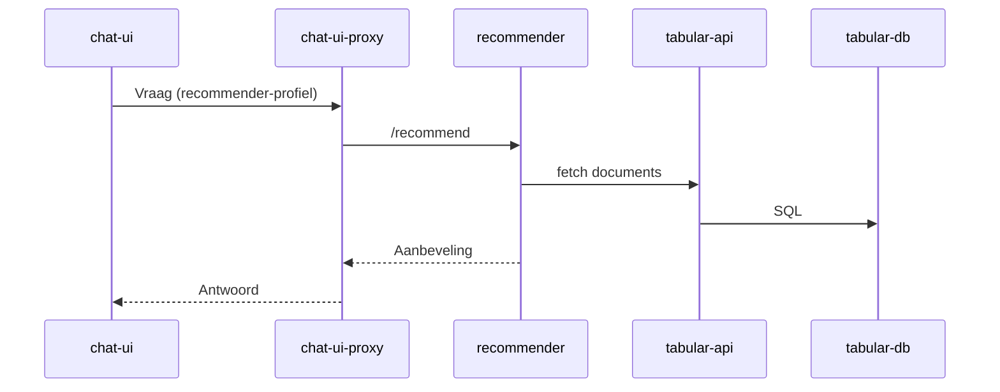
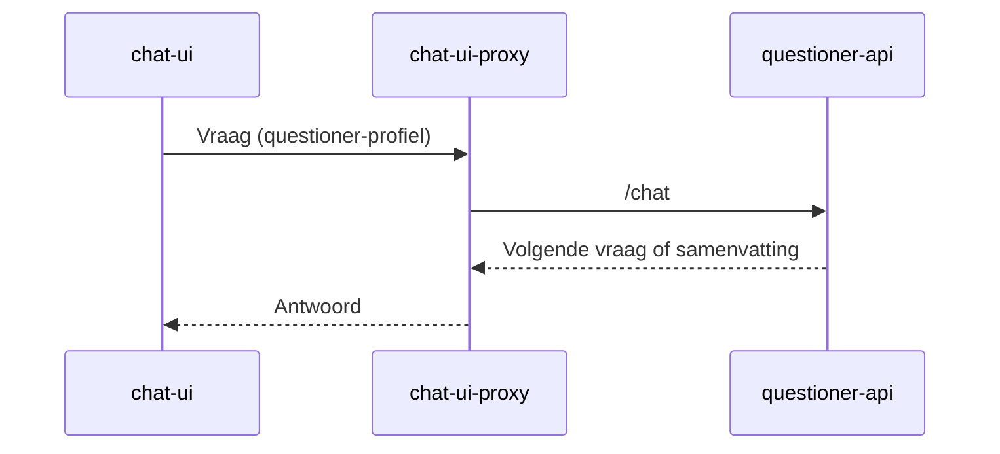
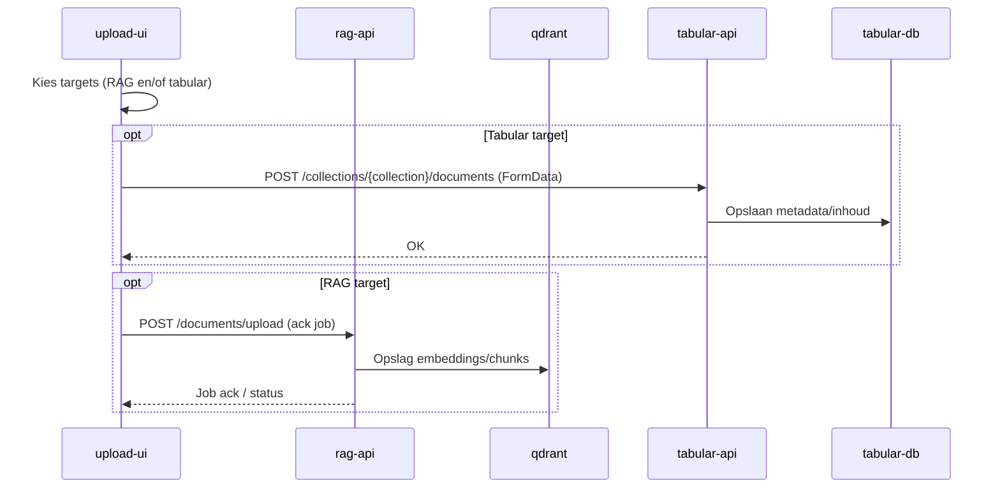

# PiXie – Architectuur & Compose-profielen

## Overzicht

PiXie bestaat uit een set containers die je per profiel kunt starten:

- `informer` – vraag/antwoord via RAG
- `recommender` – aanbevelingen op tabulaire data
- `questioner` – intake/vraaggesprek dat uitmondt in een samenvatting
- `all` – alle profielen tegelijk

Start voorbeelden:

```bash
docker compose --profile informer up -d --build
docker compose --profile recommender up -d --build
docker compose --profile questioner up -d --build
docker compose --profile all up -d --build
# alles stoppen: docker compose --profile all --profile informer --profile recommender --profile questioner down --remove-orphans
```

Je kunt ook `COMPOSE_PROFILES` in `.env` zetten (bijv. `COMPOSE_PROFILES=informer` of `COMPOSE_PROFILES=all,informer,recommender,questioner`). Dan volstaat `docker compose up -d`/`down`. Per run overschrijven kan altijd met `--profile`.

## Componenten (huidig)

| Component            | Type      | Rol                                                                                   |
|----------------------|-----------|----------------------------------------------------------------------------------------|
| `rag-api`            | FastAPI   | Retrievallaag voor RAG: ontvangt queries, haalt context op uit Qdrant en serveert antwoorden. |
| `qdrant`             | Vector DB | Vectorstore voor embeddings en similarity search.                                      |
| `informer-api`       | FastAPI   | Orkestreert informatieve Q&A bovenop rag-api: intenthandling, context ophalen, antwoord bouwen. |
| `tabular-db`         | Postgres  | Relationele opslag voor tabulaire datasets.                                            |
| `tabular-api`        | FastAPI   | API voor tabulaire data: CRUD/query bovenop Postgres voor de recommender.              |
| `recommender`        | FastAPI   | Aanbevelingsengine op tabulaire data; kan bijvragen en levert keuzes/adviezen.         |
| `questioner-api`     | FastAPI   | Orkestreert vraaggesprek en genereert samenvattingen.                                  |
| `chat-ui-*`          | Frontend  | Chat UI (per profiel/all) waar gebruikers vragen stellen en antwoorden zien.           |
| `chat-ui-proxy-*`    | BFF/proxy | Proxy/BFF die chatverkeer routeert naar informer-, recommender- en/of questioner-API.  |
| `upload-ui-*`        | Frontend  | Upload UI waarmee documenten ingest worden richting informer/rag-pijplijn.             |

## Containers per profiel

- `informer`: qdrant, rag-api, informer-api, chat-ui-informer, chat-ui-proxy-informer, upload-ui-informer
- `recommender`: tabular-db, tabular-api, recommender, chat-ui-recommender, chat-ui-proxy-recommender, upload-ui-recommender
- `questioner`: questioner-api, chat-ui-questioner, chat-ui-proxy-questioner
- `all`: combinatie van alle drie plus de `*-all` UI/proxy varianten

## Mermaid – Chat flow (informer)



## Mermaid – Chat flow (recommender)



## Mermaid – Chat flow (questioner)



## Mermaid – Upload flow (RAG / tabular)



## Healthchecks & depends_on

- Health: `/health` voor rag-api, informer-api, tabular-api, recommender; `/healthz` voor qdrant. Startperiod: rag-api 120s (model load); qdrant 20s; de rest 15s.
- Afhankelijkheden met `condition: service_healthy`: qdrant→rag-api, rag/qdrant→informer-api, tabular-db→tabular-api, tabular-api→recommender.
